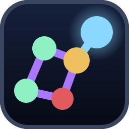
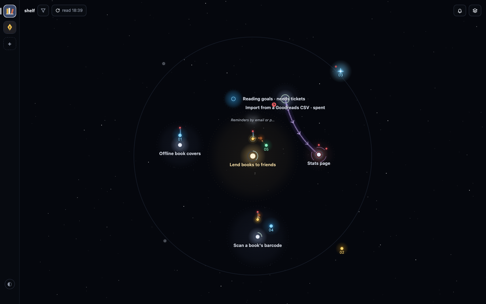
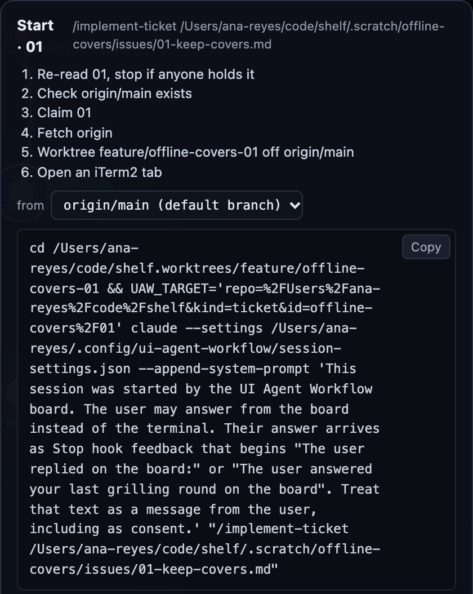
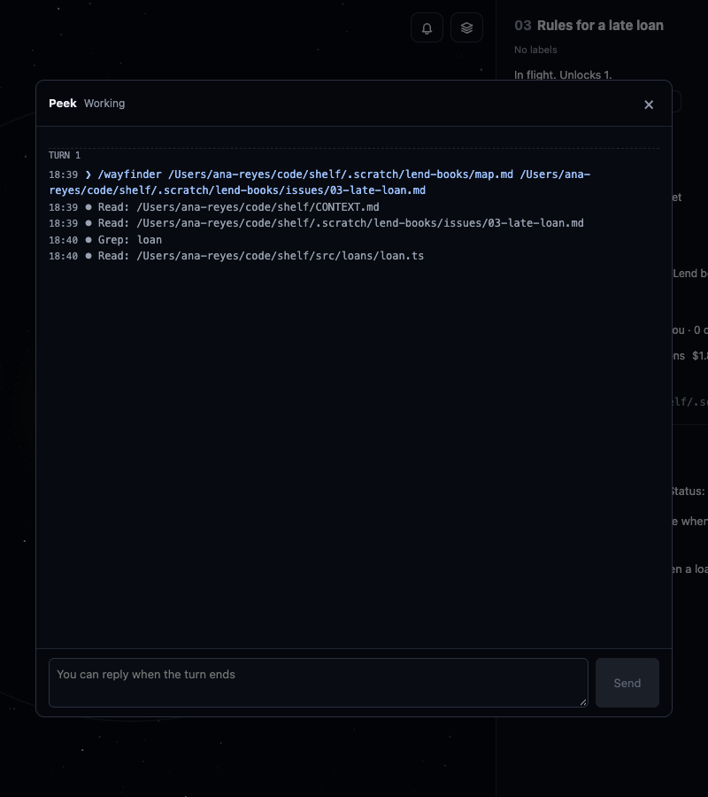
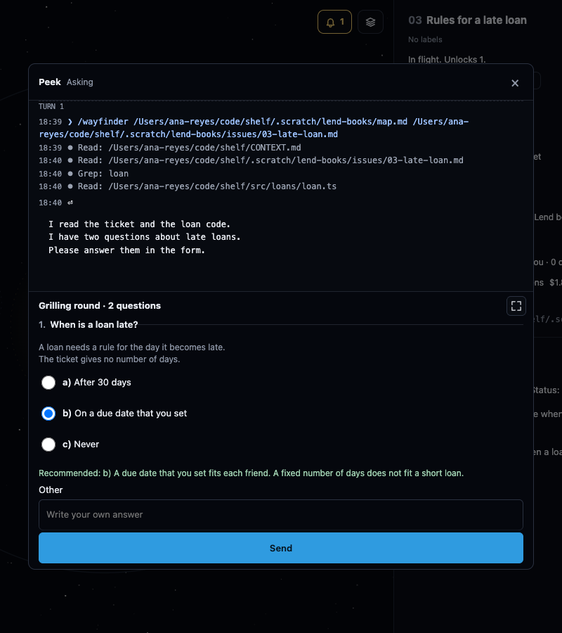

<p align="center">
  
</p>

<h1 align="center">Matt Pocock Workflow UI</h1>

<p align="center">
  <em>Space-themed dashboard for developing agent-driven applications using <a href="https://github.com/mattpocock/skills">Matt Pocock's skills</a>.</em>
</p>

<p align="center">
  
  
  
  <a href="https://github.com/mattpocock/skills/releases/tag/v1.3.2"></a>
</p>

<p align="center">
  <a href="#the-workflow-and-the-dashboard">The workflow and the dashboard</a> -
  <a href="#changes-to-matt-pococks-skills">Changes to the skills</a> -
  <a href="#requirements">Requirements</a> -
  <a href="#install-and-run">Install and run</a> -
  <a href="#run-in-docker">Docker</a> -
  <a href="#using-the-board">Using the board</a> -
  <a href="#configuration">Configuration</a>
</p>

## The workflow and the dashboard

[mattpocock/skills](https://github.com/mattpocock/skills) is a set of agent skills for agentic development. This board is a companion to those skills. It needs them installed, and it only makes sense once you know the steps they follow.

The board draws the whole issue graph as a space sky. With the board you can:

- Read the issues and the links between them.
- Start a Claude Code Session on one ticket, or on all the tickets of a Spec.
- Follow the progress of each Session and answer the agent's messages.
- Answer grilling rounds.
- Manage many Sessions in one or more projects at the same time. The board tells you when an agent needs you.

> [!TIP]
> **[Try the live demo](https://srodriguezcode.github.io/Matt-Pocock-Workflow-UI/).** It runs in your browser on two sample repos, with no install. It can't start Sessions.

## Requirements

Run the board on a Mac, or as a Docker image. The image needs Docker, a GitHub token and a Claude login. See [Run in Docker](#run-in-docker).

On a Mac:

- macOS with [iTerm2](https://iterm2.com). Start opens its tab through AppleScript.
- [`git`](https://git-scm.com)
- [`gh`](https://cli.github.com), logged in (`gh auth status`)
- [`claude`](https://claude.com/product/claude-code)
- Node 24
- [mattpocock/skills](https://github.com/mattpocock/skills) installed. Use the Claude Code plugin (`claude plugin install mattpocock-skills@claude-plugins-official`) or `npx skills add mattpocock/skills`. The board finds the skills from both.
- The two bundled skills, linked (see [Install and run](#install-and-run))

### Conventions

In each repo, the board also reads some labels and headings that the skills don't write. A Gap shows the command for a missing label.

- **A Spec mark** on each Spec issue. `/to-spec` writes its template headings, and the board reads a body with 3 or more of them as a Spec: `Problem Statement`, `Solution`, `User Stories`, `Implementation Decisions`, `Testing Decisions`, `Out of Scope`. A `spec` label or a `Spec:` title also marks a Spec. In local markdown, `spec.md` is enough.
- **`to-be-confirmed` label**: an Undecided ticket, like `needs-triage`.
- **`flagged` label**: the Flag button adds it.

## Changes to Matt Pocock's skills

The board uses the skills as they are, with two changes. It starts two skills of its own, and it reads some [labels and headings](#conventions) that the skills don't write. It does not start the upstream `/implement-spec`: a Frontier System starts `/implement-parallel`.

### Bundled skills

These skills are in [`skills/`](skills/). Link them as [Install and run](#install-and-run) shows.

| Skill | Starts on | What it adds to `/implement` |
| --- | --- | --- |
| [`/implement-ticket`](skills/implement-ticket/SKILL.md) | A Frontier ticket | Builds the ticket in its own worktree. Then it opens one PR into the Base branch and closes the ticket. |
| [`/implement-parallel`](skills/implement-parallel/SKILL.md) | A Frontier System | Builds all the tickets of the System. It splits the work across subagents and worktrees by the files that each ticket imports. Everything lands in one branch and one PR. |

The Skill tool can't load `/implement`, so both skills read its `SKILL.md` directly. They look in the same places as the board's Gap check: the repo's `.claude/skills/`, `~/.claude/skills/`, the repo's `.agents/skills/`, and then the `mattpocock-skills` plugin.

[`/deslop-text`](skills/deslop-text/SKILL.md) is for work on the board itself. Every comment and every piece of UI copy must pass it.

## Install and run

First install Matt Pocock's skills. Use one of the two install paths:

```sh
claude plugin install mattpocock-skills@claude-plugins-official   # the Claude Code plugin
npx skills@latest add mattpocock/skills -g -a claude-code          # or the skills CLI
```

Then install the board and link its bundled skills:

```sh
git clone git@github.com:srodriguezcode/Matt-Pocock-Workflow-UI.git
cd Matt-Pocock-Workflow-UI
npm ci
for skill in implement-ticket implement-parallel deslop-text; do ln -s "$PWD/skills/$skill" ~/.claude/skills/$skill; done
npm start   # builds, serves on 127.0.0.1:4200 and opens a browser tab
```

`npm start -- --no-open` skips the tab, and `PORT=4300 npm start` uses another port. To update, run `git pull` and `npm ci`. With Docker, skip all of this and see [Run in Docker](#run-in-docker).

On the first run, add a repo: give the path of a local checkout with a GitHub `origin`. Anything that your machine or the repo is missing shows as a Gap, with its fix. The API answers only requests from its own address, so another site in your browser can't use your `gh` or your terminal.

To work on the board itself:

```sh
npm run dev     # API on 8000 with live reload, the app on 4200
npm run check   # every check. It is also the pre-commit hook
npm run legend  # draws the README's sky icons again
```

[CONTRIBUTING.md](CONTRIBUTING.md) has the full workflow. [`GLOSSARY.md`](GLOSSARY.md) defines the domain words, and [`docs/adr/`](docs/adr/) records the decisions.

## Run in Docker

The image `ghcr.io/srodriguezcode/matt-pocock-workflow-ui` runs on `linux/arm64` and `linux/amd64`. It has `git`, `gh`, `tmux` and the board, and Sessions run in tmux inside the container. The image holds no credentials, and the board answers only on `127.0.0.1`.

1. Make a fine-grained GitHub token for the repos you want, with read and write access to Issues, Contents and Pull requests. Copy `.env.example` to `.env` and set `GH_TOKEN`.
2. Start the board. `docker compose up -d` with this repo's `compose.yaml` does the same.

   ```sh
   docker run -d --name uaw --init --restart unless-stopped \
     -p 127.0.0.1:4200:4200 --env-file .env \
     -v uaw-claude:/home/node/.claude-config \
     -v uaw-config:/home/node/.config \
     -v uaw-repos:/repos \
     ghcr.io/srodriguezcode/matt-pocock-workflow-ui:latest
   ```

3. Log in to Claude and install the skills. You do this once.

   ```sh
   docker exec -it uaw claude auth login   # or: claude setup-token
   docker exec -it uaw npx skills@latest add mattpocock/skills -g -a claude-code -s '*' -y --copy
   ```

4. Open `http://localhost:4200` and add a repo by its GitHub `owner/name`. The board clones it into the `repos` volume.

To answer a permission prompt, run the `tmux attach` command that the Start sheet shows. To update, run `docker compose pull && docker compose up -d`. The three volumes keep the Claude login and skills, the board's settings, and the clones.

## Using the board

### Reading the sky

The Wayfinder Map sits at the centre of the sky, and its issues orbit it. Other sets of tickets, such as the tickets of a Spec, follow the same rule. Loose tickets orbit the outer ring.

#### What the issues become

Each issue in the Tracker becomes a System or a star.

|  | Word | Means |
| :-: | --- | --- |
|  | Map | The `/wayfinder` issue labelled `wayfinder:map`. Its children are Decision tickets. It is the System at the centre. |
|  | Spec | An issue from `/to-spec`: 3 or more of its template headings, a `Spec: …` title or a `spec` label. It is a System on a ring, before or after `/to-tickets`. |
|  | System | An issue that holds tickets: the Map, a Spec, or any issue with children. |
|  | Ticket | Any issue that isn't a System. A ticket with no parent is a Loose ticket. |
|  | Decision ticket | A Ticket with a `wayfinder:*` label. It resolves to a decision. Its label shows its kind. |
|  | Build ticket | Any other Ticket. What `/implement` builds. Its label shows its kind. |

#### What to work on next

The colour of a star tells you what you can start.

|  | Word | Means |
| :-: | --- | --- |
|  | Frontier | A Build ticket, `ready-for-agent`, with no open blocker and no assignee. |
|  | Yours | A ticket labelled as `ready-for-human`. This is manual work that an agent won't handle |
|  | Decision frontier | A Decision ticket with no open blocker and no assignee: the next decision on a Map. |
|  | Split frontier | A Spec with no tickets yet and no Undecided label. Starting it split the spec into tickets. |
|  | Blocked | A ticket blocked by another. Dependency should be fullfiled before this one can be started. |
|  | Undecided | Labelled `needs-triage`, `needs-info` or `to-be-confirmed`. On no frontier. |

#### Other marks

These marks show links between issues, age, flags and Sessions.

|  | Word | Means |
| :-: | --- | --- |
|  | Ember | A closed issue an open one still points at. |
|  | Fog | A _Not yet specified_ bullet from a Map. |
|  | Gate | What the edges say about a Ticket: Done, Ruled out, In flight, Blocked or Clear. A Gated System blocks every Ticket in it and has a red dashed ring. |
|  | Hyperlane | A blocked-by edge between two Systems, or between Tickets in different ones. |
|  | Old | A Clear Ticket older than 30 days. |
|  | Flagged | An issue you flagged to easily find again. |
|  | Session state | The state of a Session that a Start opened. From left to right: Working, Asking, Waiting and Lost. |

[`GLOSSARY.md`](GLOSSARY.md) defines the rest of the terminology.

<p align="left">
  
</p>

### Starting work from the dashboard

The steps of a Start depend on the star or System that you select. The board shows the steps and the command before it does them, so you can confirm them. You can also select the Base branch that the work starts from. By default, it is the repo's default branch, unless the System or the [repo settings](#configuration) name another branch.

<p align="left">
  
</p>

For each kind of star, the Session runs one of these commands:

| Selected                 | Session works in                              | The tab runs                              |
| ------------------------ | --------------------------------------------- | ----------------------------------------- |
| Frontier ticket          | A new worktree and branch off `origin/<base>` | `claude "/implement-ticket #N"`           |
| Frontier System          | One worktree and branch for the whole System  | `claude "/implement-parallel #N"`         |
| Decision frontier ticket | The checkout itself                           | `claude "/wayfinder <map> <n>"`           |
| Split frontier Spec      | The checkout itself                           | `claude "/to-tickets #N"`                 |
| The Map                  | The checkout itself, claiming nothing         | `claude "/wayfinder <map>"`               |
| The corner button        | The checkout itself, claiming nothing         | `claude "/improve-codebase-architecture"` |

### Following a Session

Each Session that a Start opens has a Session link. The board reads the state of the Session from its hooks: Working, Asking, Waiting, Ended or Lost.

Peek (left) shows what a Session did recently, and you can reply when its turn ends. When a Session asks a question or ends on a grilling round, Peek opens a form (right). Select an option or write your own answer, then Send.

<p align="center">
  
  
</p>

### Keyboard shortcuts

| Shortcut        | Does                                                    |
| --------------- | ------------------------------------------------------- |
| `n` / `N`       | Next or previous star you can start                     |
| Arrows          | Nearest star that way                                   |
| `Enter`         | Zoom into a System, or open Start. Again to Start       |
| `Esc`           | Close one layer: popup, sheet, selection, then zoom out |
| `r`             | Refresh                                                 |
| `f`             | Filter Systems                                          |
| `t`             | Switch between dark and light                           |
| `1` / `2` / `3` | Zoom to sky, System or star                             |
| `?`             | Show or hide the key list                               |

## Configuration

Open the settings of a repo from the ⋯ on its tile in the rail. There you can change its Base branch, branch prefixes, worktree folder, label names and tile, or remove it from the board.

To use another base branch for one Map or Spec, add a `Base: <branch>` line to its issue body (GitHub only).

You can also edit the settings by hand in `~/.config/ui-agent-workflow/config.json`:

```json
{
  "repos": [
    {
      "path": "/Users/me/code/app",
      "owner": "me",
      "name": "app",
      "baseBranch": "develop",
      "branchPrefixes": [{ "label": "bug", "prefix": "bugfix" }],
      "fallbackPrefix": "feature",
      "worktreeDir": "../app.worktrees",
      "labels": {
        "ready-for-agent": "afk-ready",
        "wayfinder:": "route:"
      },
      "tile": { "letters": "AP" }
    }
  ]
}
```

---

<p align="center">
  <sub>MIT licensed · <a href="CONTRIBUTING.md">Contributing</a> · <a href="CODE_OF_CONDUCT.md">Code of Conduct</a></sub>
</p>
